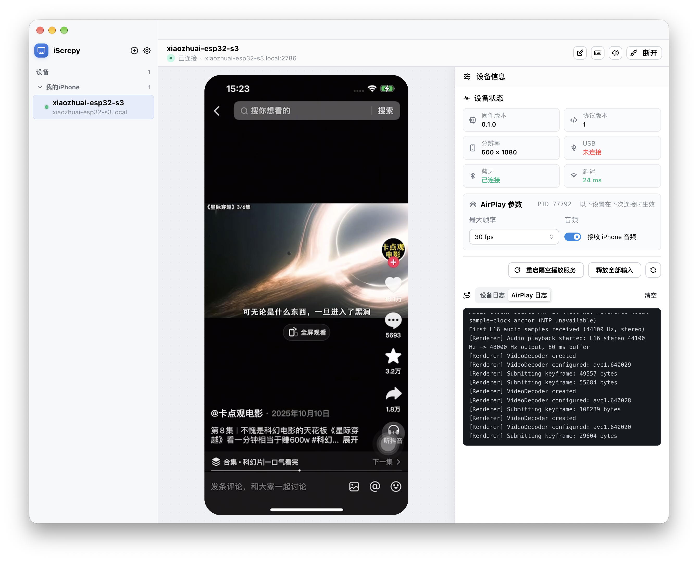
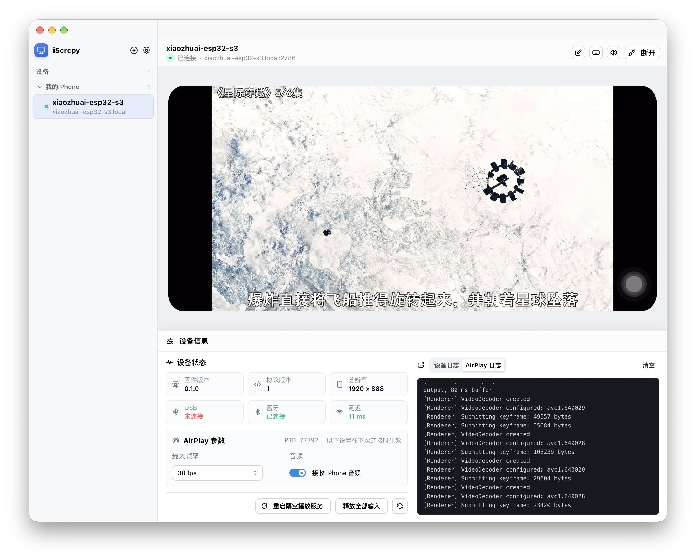

# iscrcpy

[English](README.md) | [简体中文](README_CN.md)

iscrcpy mirrors an iPhone screen to a desktop computer and controls the iPhone over a
local network. An ESP32-S3 bridge receives keyboard and mouse events through a WebSocket
connection and forwards them to the iPhone as a USB or Bluetooth LE HID device. AirPlay
screen mirroring is handled by the independent uxplay-mini project and rendered directly
inside the desktop application.

The desktop app provides device discovery, a saved device library, connection management,
live screen preview, input capture, firmware and AirPlay logs, and global connection
settings.





## How it works

```text
iPhone
  |
  | AirPlay over the local network
  v
uxplay-mini (independent process)
  |
  | H.264 + L16 audio RTP/RTCP over localhost UDP
  v
Electron main process
  |
  | encoded video frames + PCM audio
  v
WebCodecs decoder -> preview canvas
Web Audio -> system audio output

Electron
  |
  | WebSocket + JSON, port 2786
  v
ESP32-S3 firmware
  |
  +---- USB HID ------> iPhone
  |
  +---- BLE HID ------> iPhone
```

The firmware advertises `_iscrcpy-control._tcp` over mDNS. The desktop app can discover
devices automatically or connect to a manually configured host and port. Keyboard and
mouse input is sent in USB HID usage format, and the bridge can target USB, Bluetooth,
or USB with Bluetooth fallback. After a hardware control connection succeeds, the
desktop app starts an AirPlay receiver named `iscrcpy for {device name}`.

## Repository layout

| Path                   | Description                                         |
| ---------------------- | --------------------------------------------------- |
| `iscrcpy/`             | Electron, React, and TypeScript desktop application |
| `firmware/`            | ESP32-S3 PlatformIO firmware                        |
| `firmware/PROTOCOL.md` | WebSocket protocol and HID message reference        |
| `firmware/README.md`   | Firmware-specific setup notes                       |

## Requirements

### Hardware

- Only one ESP32-S3 board is required. A compatible N16R8 board with 16 MB flash
  and OPI PSRAM typically costs about US$4 / CN¥28.
- A data-capable USB connection for the initial firmware flash and USB HID operation.
- An iPhone, a 2.4 GHz or compatible Wi-Fi network, and a desktop computer.
- The ESP32-S3 and desktop computer on the same local network.

### Software

- [PlatformIO Core](https://platformio.org/) for building and flashing the firmware.
- Node.js and [pnpm](https://pnpm.io/) for the desktop application.
- A current Windows, macOS, or Linux desktop environment supported by Electron.

The desktop app starts and stops uxplay-mini with the hardware connection. Mini sends
H.264 video (PT 96) and L16 PCM audio (PT 97, 44.1 kHz stereo) to separate local RTP/RTCP
port pairs. Electron depacketizes RTP; the renderer draws video with WebCodecs and plays
audio with Web Audio. GStreamer is no longer needed. Desktop does not enable `--h265`.
Audio remains off by default; enable it in the device's AirPlay settings and restart the
receiver to apply the setting. See the [desktop development guide](iscrcpy/README.md)
for independent receiver artifacts, packaging and tests.

### iPhone setup

Enable Full Keyboard Access before using keyboard shortcuts. The setting location
depends on the iOS version:

- iOS 26 and later: **Settings > Accessibility > Keyboards & Typing**
- Older iOS versions: **Settings > Accessibility > Keyboards**

Also enable **Settings > Accessibility > Touch > AssistiveTouch**. The app displays
these prerequisites when first using its system shortcut menu.

## Set up the firmware

From the repository root:

```bash
cd firmware
cp nvs.example.csv nvs.csv
```

On Windows, copy `nvs.example.csv` to `nvs.csv` in File Explorer or with PowerShell.
Edit `nvs.csv` and fill in the following NVS values:

| Field           | Required | Notes                                                                   |
| --------------- | -------- | ----------------------------------------------------------------------- |
| `wifi_ssid`     | Yes      | Wi-Fi network name, up to 32 bytes                                      |
| `wifi_password` | Yes      | Empty, 8-63 bytes, or a 64-character hexadecimal PSK                    |
| `hostname`      | No       | DNS label used for `<hostname>.local`; defaults to a chip-specific name |
| `device_name`   | No       | HID and mDNS display name, up to 28 bytes; defaults to the hostname     |
| `access_token`  | No       | 16-128 printable ASCII characters; empty disables authentication        |

Install the Python dependency into the same Python environment used by PlatformIO:

```bash
"$(dirname "$(command -v pio)")/python" -m pip install -r requirements.txt
```

For the first flash, write the firmware and generated NVS partition together:

```bash
pio run -e esp32-s3-n16r8-factory --target upload --upload-port <serial-port>
```

Typical serial ports are `/dev/cu.usbmodem*` on macOS, `/dev/ttyACM*` on Linux, and
`COMx` on Windows. For later firmware updates, the default environment can be used:

```bash
pio run --target upload --upload-port <serial-port>
```

To inspect serial logs:

```bash
pio device monitor --port <serial-port>
```

See [firmware/README.md](firmware/README.md) for the shorter firmware reference and
[firmware/PROTOCOL.md](firmware/PROTOCOL.md) for protocol details.

## Run the desktop app

```bash
cd iscrcpy
pnpm install
pnpm dev
```

The first install downloads Electron and runs the native dependency setup.

## Usage

1. Power the ESP32-S3 bridge and make sure it is connected to the same network as the
   desktop computer.
2. Open the desktop app and wait for mDNS discovery, or select manual entry and provide
   the hostname or IP address, port `2786`, and Access Token if configured.
3. Save the device, select it in the device library, and click **Connect**.
4. On the iPhone, open **Control Center > Screen Mirroring** and choose
   `iscrcpy for {device name}`. On iOS versions where the control is hidden, add
   **Screen Mirroring** in **Settings > Control Center**.
5. Wait for the iPhone screen to appear in the iScrcpy preview. Click the viewport to
   capture the keyboard and mouse. Press `Esc` to release input and exit capture; the
   active control state is shown in the device title bar.
6. Open **Settings** to choose the global input target: **Prefer USB**, **USB only**, or
   **Bluetooth only**. Automatic reconnect and its retry interval are also global.
7. Use the device action menu to send common iPhone system shortcuts. The first use
   displays the required iPhone accessibility settings.

While a device is waiting to mirror, the preview shows a three-step setup guide. The
first two steps are marked as one-time setup per device, while screen mirroring is shown
as required for every connection.

The device panel shows firmware version, protocol version, display aspect ratio, USB
and Bluetooth connection state, latency, and combined firmware and AirPlay logs.

### AI control through MCP

Enable **Settings > AI control / MCP** to expose the selected phone to a local AI
client. Tools cover device/receiver management, phone-only screenshots, on-demand
iPhone audio, calibrated pointer gestures and HID keyboard input. The server is off
by default and uses a loopback endpoint with a Bearer token. The listen address and
port are configurable; non-loopback listening requires a security warning, and
changes while running require a confirmed MCP restart. Remote HTTP is unencrypted:
use a trusted network only and never expose it to the Internet. When MCP is enabled,
a pause/resume icon in the device toolbar cancels operations and releases input
without changing the MCP Settings switch. Pausing also blocks screenshots/audio
capture and is remembered across app restarts. Manual controls take priority; the
Settings switch can fully disable MCP at any time.

Relative mouse input requires measured calibration, periodic edge homing and visual
verification. See the [MCP setup, tools and calibration guide](iscrcpy/README.md#mcp-let-an-ai-client-operate-the-phone).

## Build and validate

Validate the desktop project:

```bash
cd iscrcpy
pnpm typecheck
pnpm lint
pnpm build
```

Create platform packages:

```bash
pnpm build:win
pnpm build:mac
pnpm build:linux
```

Build both firmware variants:

```bash
cd firmware
pio run -e esp32-s3-n16r8
pio run -e esp32-s3-n16r8-factory
```

## Security and limitations

- The control connection uses plain `ws://` rather than TLS. Access Tokens and input
  messages can be observed on the network. Use iscrcpy only on a trusted LAN.
- The firmware grants a control lease to one controller at a time. A new connection may
  replace an expired lease, but a busy device rejects additional controllers.
- Input is released when the connection lease expires, capture is lost, the target
  changes, or the user disconnects.
- Network-level access control, encrypted input transport, and desktop credential
  storage are not currently implemented.

## License

Original code and documentation in this repository are licensed under the
[MIT License](LICENSE). Copyright (c) 2026 xiaozhuai.

Third-party components retain their own licenses. In particular, the independent
uxplay-mini receiver bundled with the desktop app remains subject to its GPL and
third-party license/source obligations. See the
[desktop distribution notes](iscrcpy/README.md#build).
